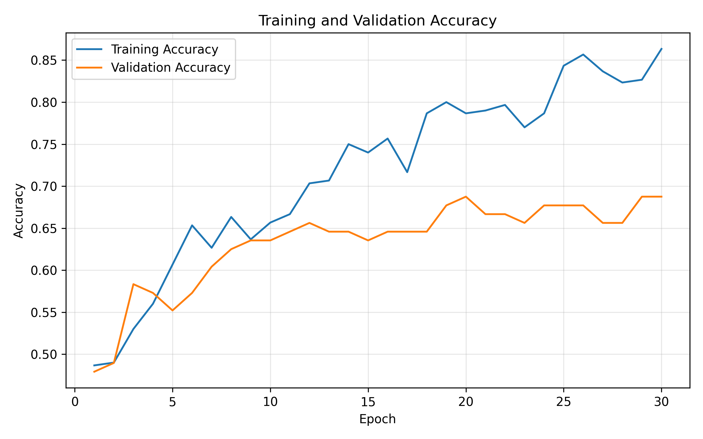
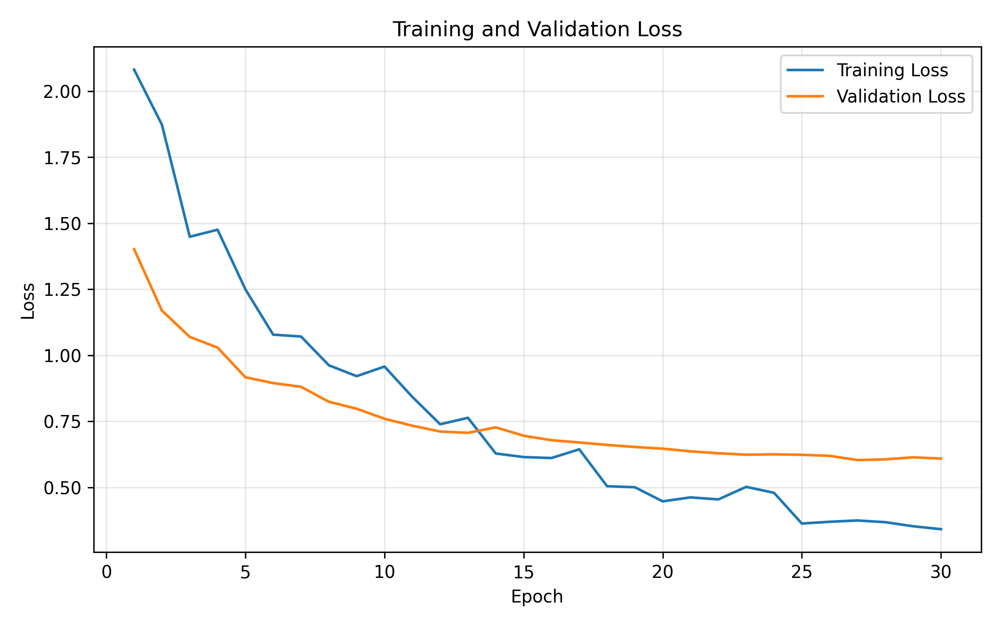
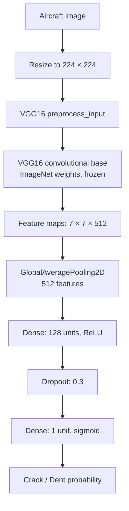

<div align="center">

# ✈️ Aircraft Damage Classification

**Classifying aircraft surface damage as cracks or dents with transfer learning**


*A modular TensorFlow/Keras computer-vision project using an ImageNet-pretrained VGG16 feature extractor.*

</div>

---

## Overview

This project trains an image classifier to distinguish between two categories of aircraft damage:

- **Crack**
- **Dent**

Instead of training a convolutional neural network from scratch, the project uses **transfer learning** with VGG16 pretrained on ImageNet. The pretrained convolutional layers are frozen, and a smaller task-specific classification head is trained on the aircraft images.

The code is organized into separate modules for configuration, data preparation, model construction, training, evaluation, and plotting.

## Results

| Metric | Result |
|---|---:|
| **Test accuracy** | **86.00%** |
| Test loss (binary cross-entropy) | 0.4261 |
| Correct test predictions | 43 / 50 |
| Training images | 300 |
| Validation images | 96 |
| Test images | 50 |
| Trainable parameters | 65,793 |
| Training epochs in the reported run | 30 |

## Training Visualizations

The plots below show the metrics from the reported 30-epoch run. The blue line is training performance; the orange line is validation performance.

### Accuracy



### Loss



**Interpretation:** Training accuracy increases through the run. Validation accuracy improves more gradually and fluctuates, while validation loss trends downward overall. Early stopping monitors validation loss and restores the best observed weights when its stopping condition is met.

## Model Architecture



### Key design choices

- **VGG16 with ImageNet weights:** reuses visual features learned from a large image dataset.
- **Frozen convolutional base:** keeps pretrained feature-extractor weights fixed during training.
- **`GlobalAveragePooling2D`:** compresses a `7 × 7 × 512` feature map to 512 values, avoiding the very large dense layer created by flattening all 25,088 values.
- **Small classification head:** `Dense(128, ReLU)`, `Dropout(0.3)`, then a one-unit sigmoid output.
- **Loss and optimizer:** binary cross-entropy with Adam at a learning rate of `0.0001`.
- **Early stopping:** monitors validation loss, uses a patience of 5 epochs, and restores the best weights.

The model has **14,780,481 total parameters**, of which **65,793 are trainable** and **14,714,688 belong to the frozen VGG16 base**.

### Image preprocessing

Images are loaded from class-specific directories, resized to the model input size, and prepared using VGG16's `preprocess_input`. This function changes RGB channel order to BGR and subtracts ImageNet channel means. Do **not** combine this pipeline with `rescale=1./255`, since that would be a different preprocessing scheme.

## Dataset

The dataset is expected to have this directory layout:

```text
aircraft_damage_dataset_v1/
├── train/
│   ├── crack/
│   └── dent/
├── valid/
│   ├── crack/
│   └── dent/
└── test/
    ├── crack/
    └── dent/
```

| Split | Crack | Dent | Total |
|---|---:|---:|---:|
| Train | 150 | 150 | 300 |
| Validation | 48 | 48 | 96 |
| Test | 25 | 25 | 50 |

**Download the dataset:** [Aircraft Damage Dataset (TAR archive)](https://cf-courses-data.s3.us.cloud-object-storage.appdomain.cloud/ZjXM4RKxlBK9__ZjHBLl5A/aircraft-damage-dataset-v1.tar)

Download and extract the archive, then update the paths in `src/config.py` to point to your local `train`, `valid`, and `test` folders. Keep the class-folder names and split structure shown above. The dataset files are kept separate from this source-code repository.

The configured class order is `crack`, then `dent`, so the generators map `crack → 0` and `dent → 1`.

## Project Structure

```text
aircraft-damage-classification/
├── src/
│   ├── __init__.py
│   ├── config.py
│   ├── preprocessing.py
│   ├── model.py
│   ├── trainer.py
│   ├── evaluator.py
│   └── visualizer.py
├── OUTPUTS/
│   ├── training_accuracy.png
│   └── training_loss.png
├── main.py
├── requirements.txt
├── .gitignore
└── README.md
```

The visualizer saves the plots to `OUTPUTS_DIR`. The README links directly to the generated images in `OUTPUTS/`, so commit those PNG files to GitHub for them to render in the README.

## Setup and Run

### 1. Clone the repository

```bash
git clone https://github.com/ayushman652/aircraft-damage-classification.git
cd aircraft-damage-classification
```

### 2. Create and activate a virtual environment

**Windows PowerShell:**

```powershell
python -m venv .venv
.\.venv\Scripts\Activate.ps1
```

**macOS / Linux:**

```bash
python -m venv .venv
source .venv/bin/activate
```

### 3. Install dependencies

```bash
python -m pip install --upgrade pip
pip install -r requirements.txt
```

### 4. Configure dataset paths

Edit `src/config.py` so `TRAIN_DIR`, `VALID_DIR`, and `TEST_DIR` point to the corresponding directories in your downloaded dataset. Confirm that `IMAGE_SIZE` is `(224, 224)` and that `OUTPUTS_DIR` points to the intended output folder.

### 5. Run training and evaluation

Run the command from the repository root:

```bash
python main.py
```

The script prepares the image generators, builds and summarizes the model, trains it with early stopping, saves the accuracy and loss plots under `OUTPUTS_DIR`, and evaluates the restored model on the test split.

**Model-saving note:** The current implementation does not save the trained model to disk. The model remains in memory until the Python process ends. Only the visualizations are saved by the project workflow.

## Requirements

The project uses:

- Python 3.10
- TensorFlow / Keras
- NumPy
- Matplotlib
- Pillow

Install the dependencies listed in `requirements.txt`.

## Dataset Source

The dataset used for this project is available from the [IBM Cloud Object Storage dataset archive](https://cf-courses-data.s3.us.cloud-object-storage.appdomain.cloud/ZjXM4RKxlBK9__ZjHBLl5A/aircraft-damage-dataset-v1.tar).

---

<div align="center">

**Built as a hands-on computer-vision and transfer-learning project.**

</div>
